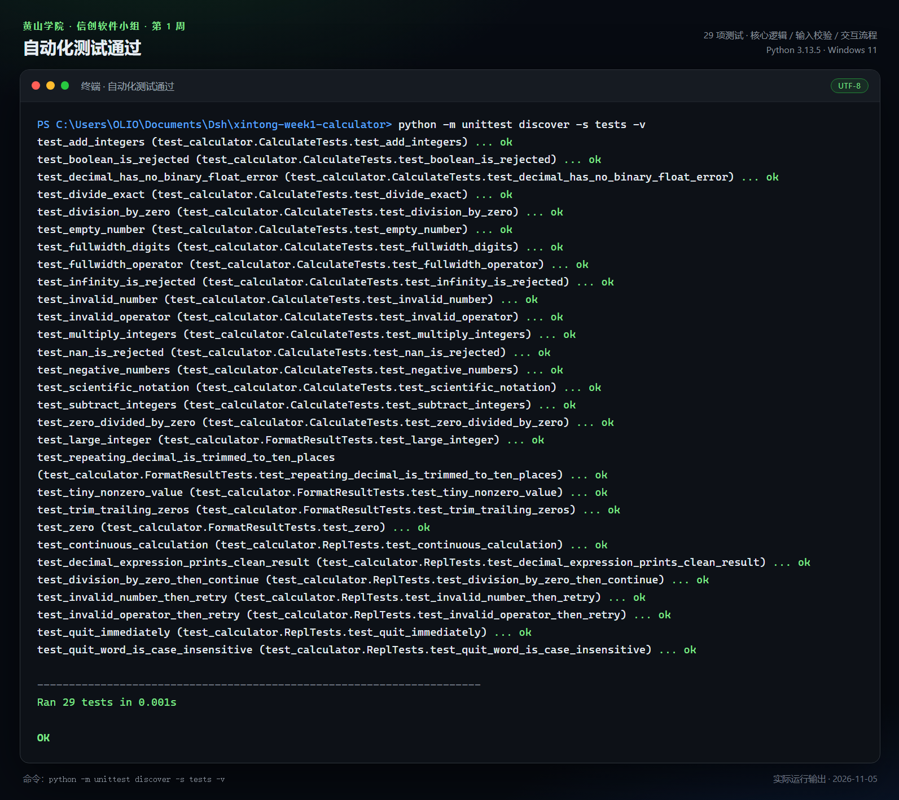
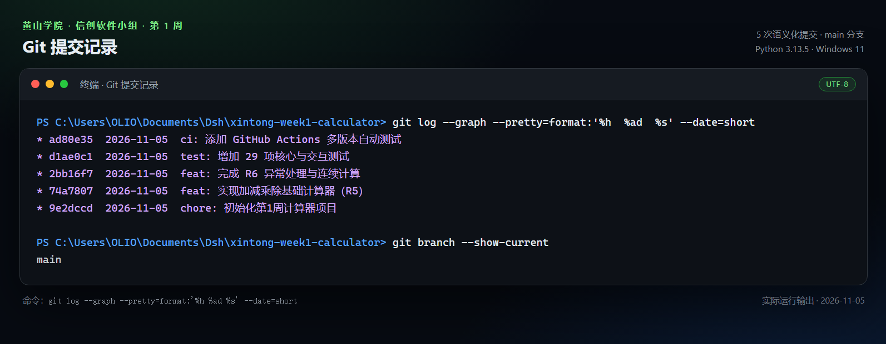
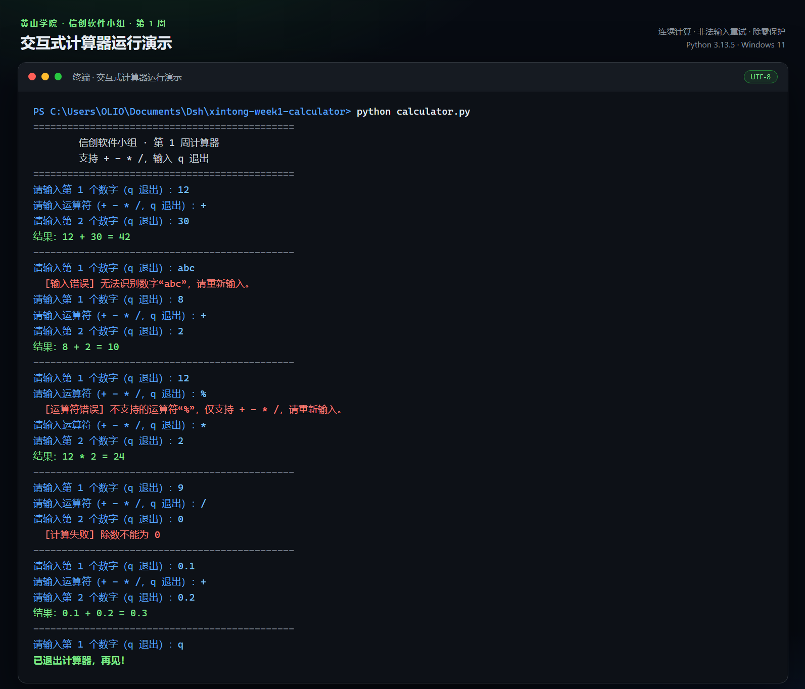

# 信创软件小组 · 第 1 周任务

## 命令行四则运算计算器

黄山学院 25 级软件工程 · 信创软件小组

按照 **R6 进阶** 标准完成：在 R5 基础计算器之上，补齐异常处理、连续计算、自动化测试、README 与规范化 Git 提交记录。


---

## 一、任务完成情况

| 层级 | 任务要求 | 完成情况 |
| --- | --- | --- |
| R5 | 搭建 Python + Git 环境 | ✅ Python 3.13.5、Git 2.53.0 |
| R5 | 实现加、减、乘、除 | ✅ `+` `-` `*` `/` 四种运算 |
| R5 | 除零判断 | ✅ 抛出 `DivisionByZeroError`，交互界面给出提示 |
| R6 | 非法数字异常捕获 | ✅ 空输入、字母、`NaN`、`Infinity` 均被拦截并允许重试 |
| R6 | 非法运算符异常捕获 | ✅ 只接受 `+ - * /`，输入错误后重新输入运算符 |
| R6 | 循环连续计算 | ✅ 一次启动可连续计算，输入 `q` / `quit` / `exit` / `退出` 结束 |
| R6 | 初始化 Git 仓库 | ✅ `main` 分支，5 次语义化核心提交（另有 `docs` 提交归档文档） |
| R6 | 编写 README | ✅ 当前文档 |
| R6 | 规范提交记录 | ✅ 采用 Conventional Commits（`feat` / `test` / `ci` / `chore`） |
| 进阶 | 自动化测试 | ✅ 29 项 `unittest` 测试，全部通过 |
| 进阶 | CI 自动测试 | ✅ GitHub Actions，Python 3.10 / 3.12 / 3.13 矩阵（已实际运行通过） |
| 进阶 | 十进制精度 | ✅ 使用 `Decimal`，`0.1 + 0.2` 输出 `0.3` |
| 进阶 | 中文输入兼容 | ✅ 支持全角数字与 `×` `÷` `＋` `－` |

## 二、快速开始

### 环境要求

- Python 3.10 及以上
- Git（仅克隆仓库时需要）
- 无任何第三方依赖

### 运行

```bash
git clone <仓库地址>
cd xintong-week1-calculator
python calculator.py
```

如果已经拿到源码，也可以直接运行：

```bash
python calculator.py
```

### 交互示例

```text
==============================================
        信创软件小组 · 第 1 周计算器
        支持 + - * /，输入 q 退出
==============================================
请输入第 1 个数字（q 退出）：12
请输入运算符（+ - * /，q 退出）：+
请输入第 2 个数字（q 退出）：30
结果：12 + 30 = 42
----------------------------------------------
请输入第 1 个数字（q 退出）：q
已退出计算器，再见！
```

## 三、项目结构

```text
xintong-week1-calculator/
├─ calculator.py              # 主程序：核心计算 + 命令行交互
├─ tests/
│  └─ test_calculator.py      # 29 项自动化测试
├─ .github/
│  └─ workflows/
│     └─ tests.yml            # GitHub Actions 自动测试
├─ docs/
│  ├─ 第1周小结.md             # 周小结（Markdown 版）
│  ├─ 第1周小结_信创软件小组.docx
│  └─ screenshots/
│     ├─ 01-demo.png          # 交互运行截图
│     ├─ 02-tests.png         # 自动化测试截图
│     └─ 03-git-log.png       # Git 提交记录截图
├─ .gitignore
├─ .gitattributes
└─ README.md
```

## 四、实现说明

### 1. 核心计算与界面分离

`calculate(left, operator, right)` 只负责计算，`run_repl(stdin, stdout)` 负责输入输出。这样既方便在终端使用，也能在测试中注入字符串流，模拟完整交互过程。

```python
def calculate(left, operator, right) -> Decimal:
    left_value = _as_decimal(left)
    right_value = _as_decimal(right)
    op = validate_operator(operator)

    if op == "/" and right_value == 0:
        raise DivisionByZeroError()
    ...
```

### 2. 使用 Decimal 保证十进制精度

二进制浮点数无法精确表示 `0.1` 和 `0.2`，直接相加会得到 `0.30000000000000004`。本项目使用 `Decimal`，内部按 28 位有效数字计算；常规结果最多显示 10 位小数，绝对值小于 `1e-10` 的非零值则保留完整小数，避免被显示成 0。因此：

```text
0.1 + 0.2 = 0.3
1 / 3     = 0.3333333333
```

### 3. 自定义异常，错误提示更明确

| 异常 | 触发场景 | 用户看到的提示 |
| --- | --- | --- |
| `InvalidNumberError` | 输入字母、空值、`NaN` 等 | 无法识别数字“abc”，请重新输入 |
| `InvalidOperatorError` | 输入 `%`、`^` 等 | 不支持的运算符“%”，请重新输入 |
| `DivisionByZeroError` | 除数为 0 | 除数不能为 0 |

所有业务异常继承自 `CalculatorError`，交互层统一捕获，不会因为一次输入错误而退出程序。

### 4. 输入规范化

通过 Unicode NFKC 规范化，把全角数字 `１２３` 转成 `123`，并兼容中文输入法常见的 `×`、`÷`、`＋`、`－`，减少“看起来输入正确却算不了”的情况。

### 5. 可测试性

`run_repl` 允许传入 `stdin` 和 `stdout`，测试用例可以模拟“先输错、再重输、最后退出”的完整会话：

```python
code, output = run_session("abc\n12\n+\n30\nq\n")
assert "无法识别数字" in output
assert "结果：12 + 30 = 42" in output
```

## 五、测试结果

运行全部测试：

```bash
python -m unittest discover -s tests -v
```

结果：

```text
----------------------------------------------------------------------
Ran 29 tests in 0.001s

OK
```

覆盖范围：

- 四则运算、负数、小数、科学计数法
- 全角数字、全角运算符
- 除零、非法数字、非法运算符、`NaN` / `Infinity`
- 结果格式化、极小值、大整数、循环小数
- 连续计算、错误后重试、退出命令、大小写兼容



## 六、Git 提交记录

核心开发过程共 5 次提交，文档和截图另外整理成 `docs` 提交，按“初始化 → R5 → R6 → 测试 → CI”的顺序推进：

| 提交 | 类型 | 说明 |
| --- | --- | --- |
| `ad80e35` | ci | 添加 GitHub Actions 多版本自动测试 |
| `d1ae0c1` | test | 增加 29 项核心与交互测试 |
| `2bb16f7` | feat | 完成 R6 异常处理与连续计算 |
| `74a7807` | feat | 实现加减乘除基础计算器（R5） |
| `9e2dccd` | chore | 初始化第1周计算器项目 |



提交信息采用 `type: 描述` 的格式：

- `feat`：新增功能
- `fix`：修复问题
- `test`：测试相关
- `docs`：文档相关
- `ci`：持续集成配置
- `chore`：工程初始化、依赖等杂项

## 七、运行截图



截图内容依次演示：

1. `12 + 30 = 42` 正常计算；
2. 输入 `abc` 被拦截，重新输入 `8 + 2`；
3. 输入 `%` 被拦截，重新输入 `12 * 2`；
4. `9 / 0` 被拦截，程序继续运行；
5. `0.1 + 0.2 = 0.3` 十进制精度；
6. 输入 `q` 正常退出。

## 八、常见问题

### Q1：Windows 终端中文显示乱码怎么办？

建议使用 Windows Terminal（PowerShell 5.1 或 7 都可以）。如果中文仍然乱码，先执行下面的命令，或者给 Python 设置 `PYTHONIOENCODING=utf-8`：

```bat
chcp 65001
```

再运行 `python calculator.py`。

### Q2：提示 `'python' 不是内部或外部命令`？

安装 Python 时勾选 **Add Python to PATH**，或改用 Anaconda Prompt / `py` 启动器。

### Q3：为什么常规结果最多显示 10 位小数？

这是显示层的取舍：内部按 28 位精度计算，常规结果最多展示 10 位小数并去掉末尾的 0，避免 `1 / 3` 输出一长串数字。绝对值小于 `1e-10` 的非零值会保留完整小数，否则会被四舍五入成 0。需要更高精度时可以调整 `format_result` 中的格式。

### Q4：如何增加一个新运算？

1. 在 `OPERATORS` 中登记运算符；
2. 在 `calculate` 中增加对应分支；
3. 在 `tests/test_calculator.py` 中补充正常与异常用例；
4. 运行 `python -m unittest discover -s tests -v`。

## 九、已知限制与后续计划

当前版本聚焦第 1 周任务，已知限制：

- 只支持两个操作数，不支持 `1 + 2 * 3` 这类带优先级的表达式；
- 常规结果最多显示 10 位小数；绝对值小于 `1e-10` 的非零值保留完整小数；
- 不保存历史记录，退出后不保留上次结果。

后续可以扩展：

- 表达式解析与运算符优先级；
- 计算历史、撤销与 `ans` 引用上次结果；
- 图形界面或 Web 版本；
- 更多数学函数（幂、开方、三角函数）。

## 十、仓库地址

仓库已设为公开，组长和同学可以直接打开：

```text
https://github.com/zishiyi818-hue/xintong-week1-calculator
```

## 十一、提交清单

- [x] `calculator.py` 源码
- [x] `tests/test_calculator.py` 自动化测试
- [x] GitHub Actions 配置
- [x] `README.md`
- [x] 运行截图 3 张
- [x] 第 1 周小结（Markdown + Word）
- [x] GitHub 远程仓库链接（公开仓库，见第十节）

---

**作者**：信创软件小组 · 黄山学院 25 级软件工程
**完成日期**：2026-11-05
