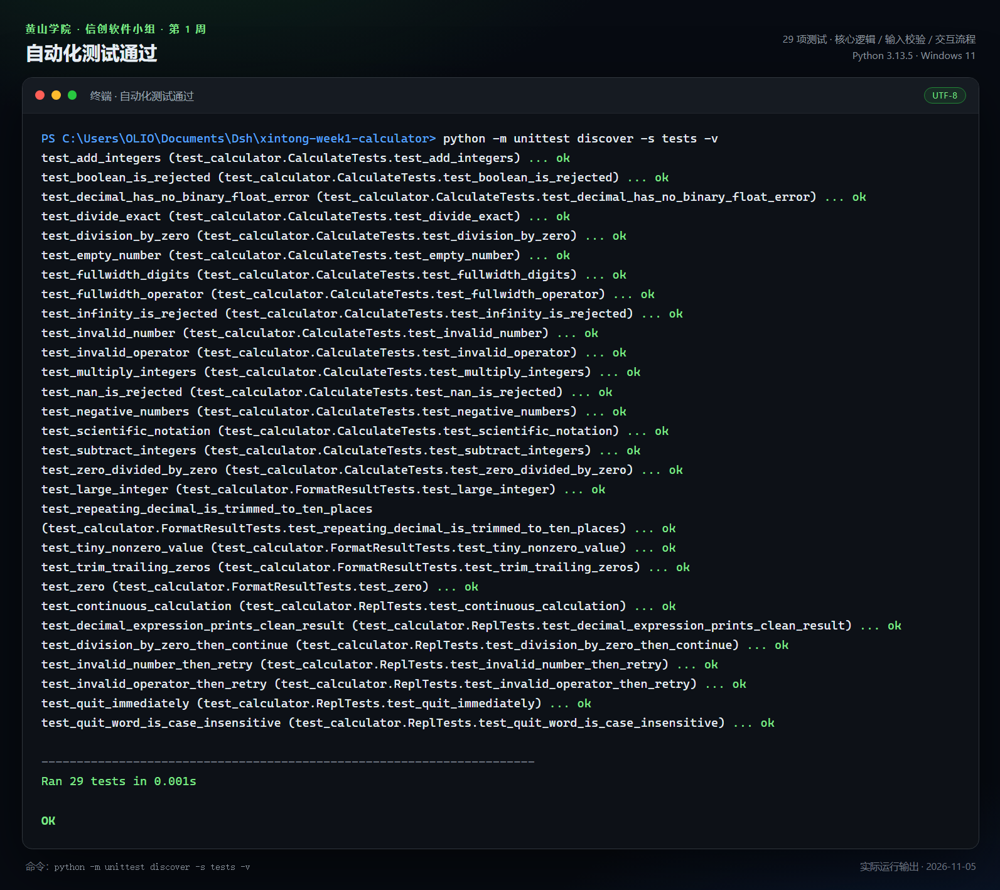
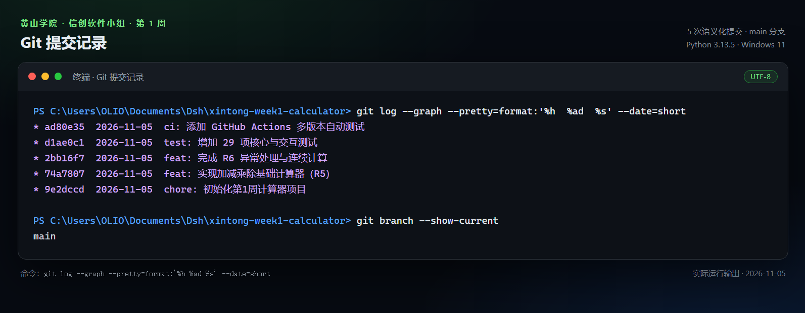
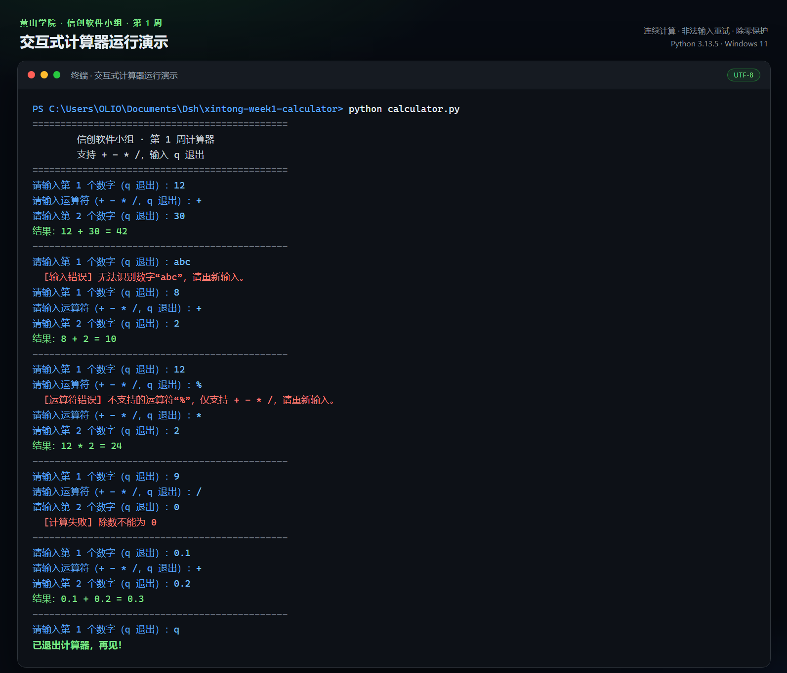

# 信创软件小组 · 第 1 周任务小结

## 基本信息

| 项目 | 内容 |
| --- | --- |
| 姓名 | 已隐去 |
| 学号 | 已隐去 |
| 年级 | 25 级（大二） |
| 专业 | 软件工程 |
| 小组 | 信创软件小组 |
| 完成日期 | 2026 年 11 月 5 日 |
| 完成层级 | R6 进阶 |
| 项目名称 | 命令行四则运算计算器 |

## 一、任务理解

本周任务分为 R5 底线与 R6 进阶两个层次。R5 要求搭建 Python + Git 环境，完成一个支持加、减、乘、除的基础计算器，并正确处理除数为 0 的情况；R6 则要求在此基础上增加异常捕获、循环连续计算，并把 Git 仓库、README 和提交记录做得规范。

一开始我只想先把四则运算跑通，除零别崩就行。后来测试时特意试了中文输入法下的全角数字和 `×`、`÷`，发现不做规范化就会报“无法识别数字”；再加上交互流程没法用普通单元测试覆盖，我才决定把计算核心和输入输出拆开，补上异常体系和可注入的 `stdin` / `stdout`。这个过程比写四个运算分支花的时间还多。

## 二、完成过程

### 1. 环境准备

- 检查 Python 版本：Python 3.13.5；
- 检查 Git 版本：Git 2.53.0；
- 配置 Git 用户名与邮箱；
- 新建独立项目目录，执行 `git init -b main`。

### 2. 需求拆解

把任务拆成四块：

1. **计算核心**：只负责四则运算和除零判断；
2. **输入校验**：把非法数字、非法运算符转换成明确的错误提示；
3. **交互循环**：一次启动可以连续计算，输入 `q` 退出；
4. **工程配套**：测试、README、提交规范、CI。

这种拆分让“计算”和“输入输出”互不纠缠，后续增加新运算时不需要重写整个程序。

### 3. 编码实现

先完成 R5 版本：用 `float` 接收两个数字，根据运算符返回结果，除数为 0 时抛出 `ZeroDivisionError`。这个版本只有几十行，跑通四则运算没问题，但马上暴露了两个毛病：`0.1 + 0.2` 会输出 `0.30000000000000004`；输入字母或 `%` 会直接把 Python 的报错甩到终端，程序随即退出。

于是 R6 重构时，我把“计算”和“输入输出”拆开：

- 使用 `Decimal` 替代 `float`，内部按 28 位有效数字计算；
- 增加 `InvalidNumberError`、`InvalidOperatorError`、`DivisionByZeroError`；
- 把 `run_repl(stdin, stdout)` 的输入输出做成可注入参数；
- 用 `unicodedata.normalize("NFKC", ...)` 兼容全角数字和 `×`、`÷`；
- 格式化结果：常规结果最多保留 10 位小数；绝对值小于 `1e-10` 的非零值保留完整小数，避免被显示成 0。

### 4. 测试与 CI

最初只测了 `calculate()` 的四则运算，后来发现真正容易出问题的是交互流程：输错数字后能不能重试、除零后循环会不会断、`q` 能不能退出。于是把 `run_repl` 的完整会话也纳入测试，最终共 29 项。随后添加 GitHub Actions，在 Python 3.10、3.12、3.13 三个版本上自动运行测试和命令行冒烟测试。

### 5. 文档与提交

补齐 README、运行截图和周小结；提交信息统一采用 `type: 描述` 的格式，按“初始化 → R5 → R6 → 测试 → CI”的顺序提交，保证历史可读。

## 三、完成情况

| 要求 | 完成情况 | 说明 |
| --- | --- | --- |
| Python + Git 环境 | 已完成 | Python 3.13.5，Git 2.53.0 |
| 加、减、乘、除 | 已完成 | `+` `-` `*` `/` |
| 除零判断 | 已完成 | 提示“除数不能为 0”，程序不退出 |
| 非法数字 | 已完成 | 字母、空值、`NaN`、`Infinity` 均被拦截 |
| 非法运算符 | 已完成 | 只接受四种运算符，错误后可重输 |
| 循环连续计算 | 已完成 | 支持多次计算，`q` / `quit` / `exit` / `退出` 结束 |
| Git 仓库 | 已完成 | `main` 分支，5 次核心开发提交 + `docs` 提交 |
| README | 已完成 | 功能、运行、测试、提交规范齐全 |
| 规范提交 | 已完成 | Conventional Commits |
| 自动化测试 | 进阶完成 | 29 项测试全部通过 |
| CI | 已跑通 | GitHub Actions 三版本矩阵，运行成功 |
| 十进制精度 | 进阶完成 | `0.1 + 0.2 = 0.3` |

## 四、关键实现

### 1. 计算与界面分离

`calculate(left, operator, right)` 不读取键盘，也不打印内容，只做三件事：解析操作数、校验运算符、执行运算。命令行界面由 `run_repl` 负责。这样同一套计算逻辑既可以被终端调用，也可以被测试直接调用。

### 2. 用 Decimal 解决浮点误差

如果直接用 `float`：

```python
>>> 0.1 + 0.2
0.30000000000000004
```

改用 `Decimal` 后：

```text
0.1 + 0.2 = 0.3
```

内部按 28 位有效数字计算。常规结果最多保留 10 位小数，既保证日常精度，也不会让 `1 / 3` 输出一长串数字；绝对值小于 `1e-10` 的非零值则保留完整小数，避免被四舍五入成 0。

### 3. 自定义异常体系

| 异常类 | 触发条件 | 处理方式 |
| --- | --- | --- |
| `InvalidNumberError` | 输入不是有限数字 | 提示后重新输入数字 |
| `InvalidOperatorError` | 运算符不在 `+ - * /` 中 | 提示后重新输入运算符 |
| `DivisionByZeroError` | 除数为 0 | 提示后回到下一次计算 |

三个异常都继承自 `CalculatorError`，交互层统一捕获。这样既不会把 Python 的原始报错直接甩给用户，也不会因为一次输入错误就结束整个程序。

### 4. 可测试的交互层

`run_repl(stdin=None, stdout=None)` 允许传入文本流。测试时可以模拟一整套操作：

```python
code, output = run_session("abc\n12\n+\n30\nq\n")
assert "无法识别数字" in output
assert "结果：12 + 30 = 42" in output
```

这比手工点终端更稳定，也方便以后做回归测试。

## 五、测试结果

执行命令：

```bash
python -m unittest discover -s tests -v
```

结果为：

```text
Ran 29 tests in 0.001s

OK
```

测试覆盖：

- 四则运算、负数、小数、科学计数法；
- 全角数字、全角运算符；
- 除零、非法数字、非法运算符、`NaN` / `Infinity`；
- 结果格式化、极小值、大整数、循环小数；
- 连续计算、错误后重试、退出命令、大小写兼容。



## 六、Git 与工程规范

核心开发过程共 5 次提交，文档和截图另外整理成 `docs` 提交：

| 提交 | 说明 |
| --- | --- |
| `9e2dccd` | chore: 初始化第1周计算器项目 |
| `74a7807` | feat: 实现加减乘除基础计算器（R5） |
| `2bb16f7` | feat: 完成 R6 异常处理与连续计算 |
| `d1ae0c1` | test: 增加 29 项核心与交互测试 |
| `ad80e35` | ci: 添加 GitHub Actions 多版本自动测试 |

另外补充 `.gitignore`、`.gitattributes` 和 `README.md`，避免把 `__pycache__`、虚拟环境、编辑器配置提交进仓库，并统一换行符为 LF。



## 七、遇到的问题与解决

| 问题 | 原因 | 解决方式 |
| --- | --- | --- |
| R5 版 `0.1 + 0.2` 得到 `0.30000000000000004` | 二进制浮点数无法精确表示十进制小数 | 改用 `Decimal`，统一在计算层转换 |
| R5 版输入字母时直接抛 `ValueError` 退出 | 没有捕获转换异常 | 增加 `InvalidNumberError`，在读取层循环重试 |
| R5 版输入 `%` 后直接抛 `ValueError` 退出 | 只判断了四种运算符，没有兜底 | 增加 `InvalidOperatorError`，提示后重输 |
| 交互流程不好写测试 | `input()` 和 `print()` 与终端强绑定 | 把 `stdin` / `stdout` 作为参数注入 |
| 全角数字和 `×`、`÷` 无法识别 | 用户输入没有做 Unicode 规范化 | 用 NFKC 统一转成半角写法 |
| 换行符可能不一致 | Windows 与 Linux 默认换行不同 | 增加 `.gitattributes`，统一为 LF |

## 八、不足与改进

1. **只支持两个操作数**：程序没有表达式概念，不能计算 `1 + 2 * 3`，也没有运算符优先级。下一步可以引入表达式解析。
2. **显示精度没有做成可配置项**：常规结果固定 10 位小数，极小值又走另一套格式；后续可以把精度做成参数，让显示规则更统一。
3. **没有历史记录**：退出后不保存计算历史，也不能用 `ans` 引用上一次结果。
4. **测试覆盖还可以更细**：目前以功能测试为主，后续可以补充边界值和异常路径的覆盖率统计。
5. **代码风格检查还没接入**：目前只跑了单元测试，没有配置 ruff/flake8；后续可以把格式检查也加进 CI。

## 九、下周计划

1. 学习并实现简单的表达式解析，先让 `1 + 2 * 3` 按优先级算出 7，而不是只支持两个数；
2. 给计算器增加会话历史，至少能用 `ans` 引用上一次结果；
3. 用 `coverage` 跑一遍测试，看看异常分支还有哪些没覆盖；
4. 练习功能分支 + Pull Request，不再直接往 `main` 上提交；
5. 根据组长和同学反馈继续改 README 与周小结。

## 十、交付清单

- [x] `calculator.py` 源码
- [x] `tests/test_calculator.py` 自动化测试
- [x] GitHub Actions 配置
- [x] `README.md`
- [x] 交互运行截图
- [x] 自动化测试截图
- [x] Git 提交记录截图
- [x] 第 1 周小结（Markdown + Word）
- [x] GitHub 远程仓库：https://github.com/zishiyi818-hue/xintong-week1-calculator （公开仓库，可直接访问）

## 附：运行方式

```bash
python calculator.py
```

输入两个数字和一个运算符即可计算；输入 `q`、`quit`、`exit` 或 `退出` 结束程序。



---

**签名**：已隐去
**日期**：2026 年 11 月 5 日
